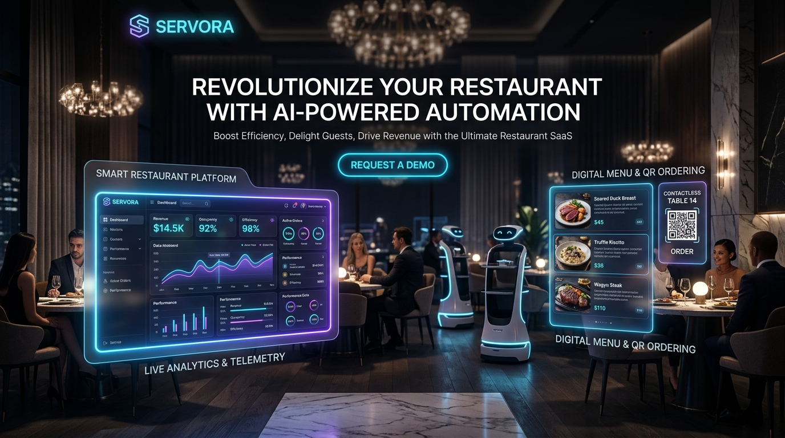
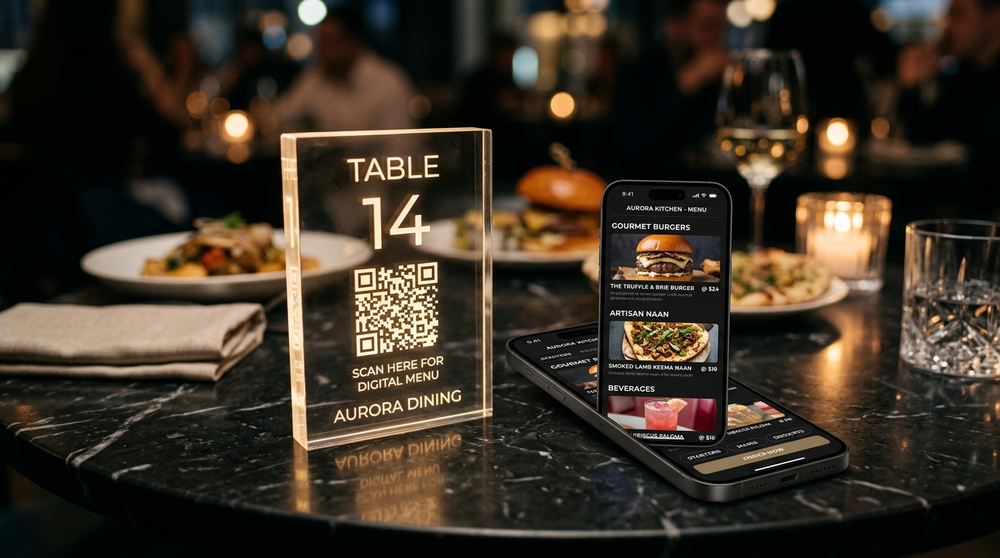
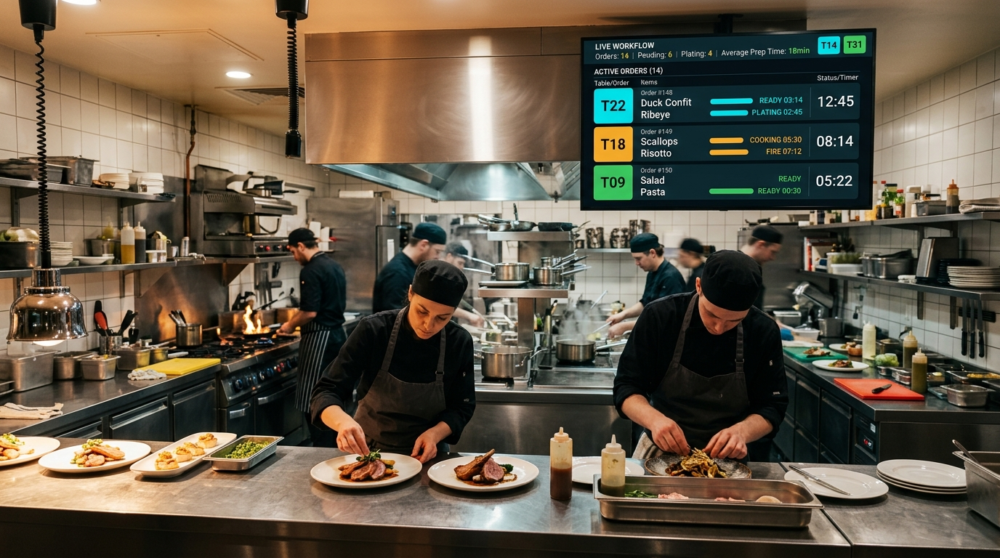
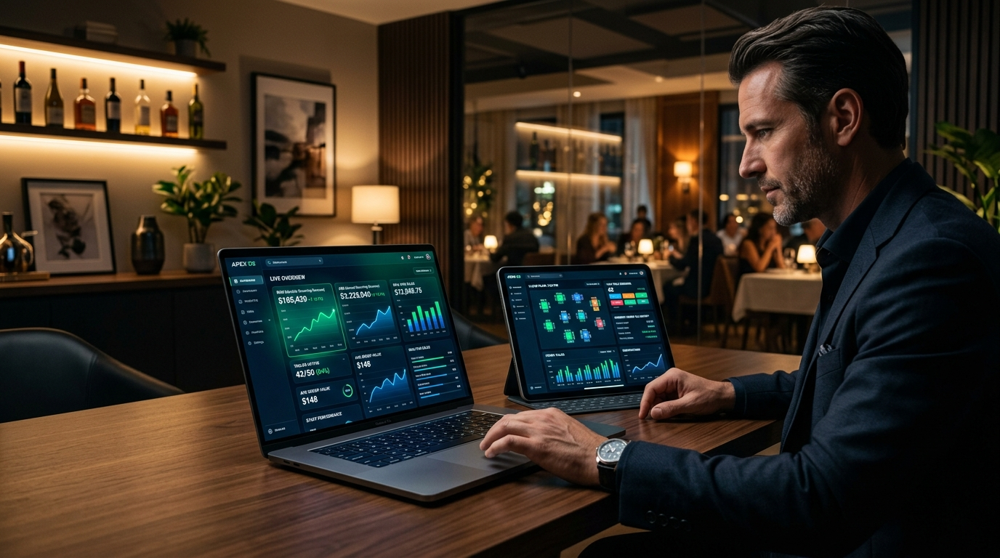
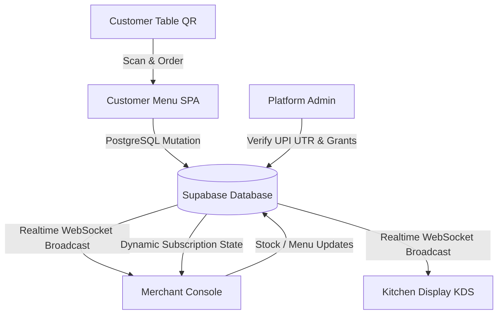

# 🍽️ Servora (FoodieTech) — Next-Gen Autonomous Restaurant Platform & SaaS Engine

<div align="center">



[](https://vitejs.dev/)
[](https://reactjs.org/)
[](https://supabase.com/)
[](https://tailwindcss.com/)
[](LICENSE)

**An ultra-modern, real-time restaurant operating system and multi-tenant SaaS ecosystem powered by 100% dynamic PostgreSQL data streams, contactless QR ordering, live kitchen telemetry, and automated financial intelligence.**

[Explore Features](#-core-platform-pillars) • [Live Demos & Visuals](#-concept-art--visual-showcases) • [Architecture](#-system-architecture) • [Getting Started](#-quick-start-guide)

</div>

---

## 📸 Concept Art & Visual Showcases

### 1. Smart Table QR Ordering & Interactive Menu
> Seamless table-side experience with instant QR scanning, draggable cart, dynamic menu categories, and live order tracking.

<div align="center">



</div>

---

### 2. High-Precision Kitchen Telemetry & Live KDS
> Real-time order dispatch, automated ticket progression, prep timers, and instant kitchen-to-floor synchronization.

<div align="center">



</div>

---

### 3. Executive SaaS Analytics & Multi-Tenant Command Hub
> Complete merchant intelligence suite with real-time sales telemetry, table occupancy metrics, and cross-channel revenue streams.

<div align="center">



</div>

---

### 4. Platform SuperAdmin Financial Control (`/admin/revenue`)
> Real-time SaaS telemetry tracking Net MRR, ARR, ARPU, LTV, Plan Tier Distribution, and GateSphere UPI payment verification.

<div align="center">


</div>

---

## 🌟 Core Platform Pillars

### 📱 1. Customer Dining Experience
* **Contactless QR Ordering**: Scan-and-order flow tied directly to table sessions (`/menu/:restaurantId?table=N`).
* **Interactive Dynamic Catalog**: Live search, category filtering, dietary indicators, spice levels, and instant out-of-stock badges.
* **Draggable Smart Cart**: Physics-based floating cart button with boundary constraints and frictionless item adjustment.
* **Live Order Progression**: Real-time status tracker (Placed ➔ In Kitchen ➔ Cooking ➔ Ready ➔ Served).
* **Instant Waiter Calling**: One-tap waiter assistance broadcasting directly to merchant notification channels.

### 🏪 2. Merchant Operations & Floor Management
* **100% Dynamic Menu Engineering**: Instant creation, price updates, category management, and single-click stock toggling stored authoritatively in Supabase.
* **Table & QR Network Generator**: Automated generation and bulk export of high-resolution QR codes with customizable table limits.
* **Live Session Monitoring**: Visual floor map displaying active dining sessions, open carts, and table occupancy.
* **Realtime Kitchen Display System (KDS)**: Order queue synchronization with auditory alerts and status dispatch.
* **Merchant Multi-Tenant Boundary**: Secure route authentication (`MerchantProtectedRoute`) isolating tenant resources.

### 🛡️ 3. SuperAdmin Financial Intelligence & GateSphere Engine
* **SaaS Telemetry Suite**: Live calculation of Monthly Recurring Revenue (MRR), Annual Run Rate (ARR), Average Revenue Per User (ARPU), and Lifetime Value (LTV).
* **GateSphere Manual UPI Payment Gateway**: Automated UTR matching and instant one-click subscription approval.
* **Subscription Tier Engine**: Granular limits enforcement (Starter, Pro, Enterprise) on menu items, active tables, and analytics access.
* **Forensic Audit Logging**: Cryptographic tracking of administrative actions, plan overrides, and payment verification records.

---

## ⚡ System Architecture



### 🗄️ Database-First Dynamic Hydration
* **Zero Client-Side Mock Caching**: Removed legacy `localStorage` overrides in favor of direct Supabase PostgreSQL streaming for single-source-of-truth consistency.
* **Realtime Event Channels**:
  * `orders:rid=<uuid>`: Instantaneous order placement and status updates.
  * `waiter-toasts:rid=<uuid>`: Real-time service requests.
  * `table_sessions`: Live table status and active party counts.
  * `subscriptions`: Dynamic lock/unlock triggers upon admin payment verification.

---

## 🛠️ Tech Stack

| Layer | Technology |
|---|---|
| **Frontend Framework** | [React 18](https://reactjs.org/) + [Vite](https://vitejs.dev/) |
| **Styling & UI** | [Tailwind CSS](https://tailwindcss.com/) + [shadcn/ui](https://ui.shadcn.com/) |
| **Animations** | [Framer Motion](https://www.framer.com/motion/) |
| **Icons** | [Lucide React](https://lucide.dev/) |
| **Database & Realtime** | [Supabase](https://supabase.com/) (PostgreSQL + PostgREST + WebSockets) |
| **Authentication** | Supabase Auth + Multi-Tenant RBAC Protection |
| **Analytics & Charts** | Recharts + Custom Telemetry Engines |

---

## 🚀 Quick Start Guide

### Prerequisites
* **Node.js** v18.0 or higher
* **npm** or **yarn** / **pnpm**
* A free [Supabase](https://supabase.com/) project

### 1. Clone & Install
```bash
# Clone the repository
git clone https://github.com/your-org/foodie-tech.git
cd foodie-tech/client

# Install dependencies
npm install
```

### 2. Configure Environment Variables
Create a `.env` file in `client/`:
```env
VITE_SUPABASE_URL=https://your-project-id.supabase.co
VITE_SUPABASE_ANON_KEY=your-anon-key-here
VITE_ENABLE_REVENUE_METRICS=true
```

### 3. Launch Development Server
```bash
npm run dev
```

Visit `https://servora.quantumesh.in` in production or `http://localhost:5173` locally.

---

## 📱 URL Routing Sitemap

| Route | Description | Access Level |
|---|---|---|
| `/` | Servora Marketing & Product Showcase | Public |
| `/login` | Merchant & Partner Portal Login | Public |
| `/register` | New Merchant Onboarding & Setup | Public |
| `/menu/:restaurantId` | Live Digital Customer Ordering Menu | Public (QR Scanned) |
| `/console/:restaurantId` | Merchant Dashboard & Kitchen Center | Protected (Merchant) |
| `/admin/revenue` | SuperAdmin Financial Intelligence Suite | Protected (Admin) |

---

## 📄 License & Acknowledgements

This project is licensed under the **MIT License** — see the [LICENSE](LICENSE) file for details.

Special thanks to:
* [Supabase](https://supabase.com/) for PostgreSQL and Realtime infrastructure.
* [Tailwind CSS](https://tailwindcss.com/) & [shadcn/ui](https://ui.shadcn.com/) for UI architecture.
* [Framer Motion](https://www.framer.com/motion/) for fluid interface physics.

---

<div align="center">

**Servora** — *Transforming the Global Dining Experience with Autonomous Intelligence.* 🍽️✨

</div>
